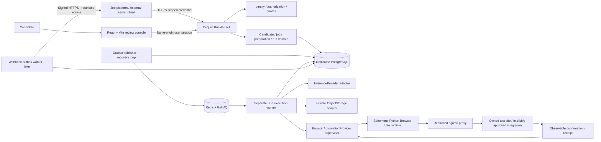
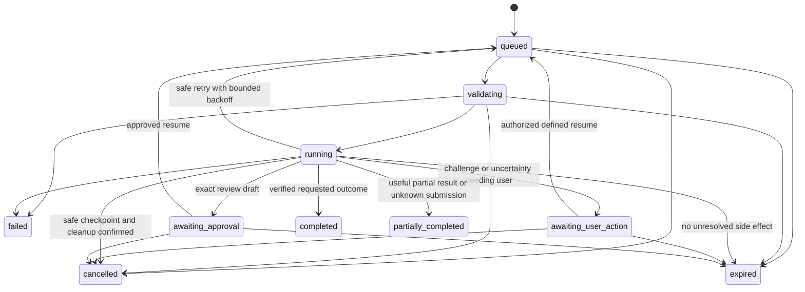

# Architecture proposal: AI Job Automation Service

**Status:** design proposal, partially superseded. Research date: 2026-10-10.

> **Implementation update (2026-11-06):** M1–M3 now run on a native Cequre 1.0.8 backend in `cequre/` (collections, custom routes, local-API transactions and in-process cron). The separate BullMQ/BullMQ-worker/Redis execution design described below is superseded for the implemented intelligence milestones: acceptance triggers execution immediately and a Cequre cron recovers queued runs every minute. PostgreSQL is still the system of record. The browser, approval and submission milestones remain proposals. See [README](../README.md) and [setup](setup.md) for the running system.

## 1. Repository assessment and approved constraints

Inspection of `/home/mrjay/auto_apply` found only Freebuff project metadata. This is not a Git repository. There are no application files, package manifests, lockfiles, tests, deployment definitions, or platform models. The owner confirmed this is a **new standalone product**, not an extension of an existing checkout.

| Area | Established facts / boundary |
|---|---|
| Frontend | Owner selected React + Vite; no existing frontend conventions |
| Backend | Owner selected Cequre; local CLI reports 1.0.3 |
| Runtime tools | Bun 1.4.2, Node 24.13.0, Python 3.14.7, uv 0.12.10, Docker 29.6.0, psql 18.6 available; running services and dependency compatibility not tested |
| Auth, profile, CV, job models | No existing implementation available; do not infer schemas or share another product's DB |
| Storage, DB, cache, queue | No project configuration exists; recommend independent PostgreSQL and Redis |
| Deployment | Owner approved self-hosted containers; no hosting account or deployment created |
| Rollout | Owner approved analysis/matching/tailoring first, browser workflow later |
| License | Owner reports solo/fewer than 10 total employees and contractors; see §3 |

**Reuse by API, not imports:** another platform may supply authorized profile/CV snapshots and job descriptions, render structured tailoring artifacts in its own templates, own candidate review, and update its application tracker. No such APIs have been inspected. An adapter for authenticated resource references is deferred until that platform's resource API, consent semantics, and permission model are available. Snapshot ingestion avoids unrestricted URL fetches in the first release.

**Acceptance package:** this document, the linked OpenAPI JSON, reference SQL, and validation report cover the ten requested pre-implementation deliverables. They are not the MVP. Endpoint availability must be advertised truthfully throughout incremental implementation.

## 2. Architecture and ownership

Start with **one modular Cequre backend, a separate TypeScript execution worker, an isolated Python browser runtime, and a React/Vite review console**. These are process boundaries, not a fleet of independently versioned domain microservices.

- **Public API:** `/v1`, DTO validation, authentication, authorization, quotas, idempotency, run creation/status/control, artifact retrieval. No long-running AI/browser task in request handlers.
- **Identity:** registered clients/scoped hashed API keys; standalone console users and tenant memberships through Cequre auth. No public developer signup in the MVP.
- **Candidate adapter:** validated minimal immutable snapshot. Candidate facts carry stable source IDs. No authoritative CV editor or profile management in this service.
- **Job intelligence:** deterministic normalization plus a replaceable structured-output AI adapter; explainable requirement assessments, missing evidence and limitations; no hiring-probability score.
- **Preparation:** separate versioned structured CV and application-answer artifacts. Original data unchanged. Generated suggestions are labeled and kept separate from source facts.
- **Execution domain:** deterministic lifecycle, tenant ownership, approvals, deadlines, cancellation, attempts, event sequence and side-effect safety.
- **Worker:** consumes IDs from BullMQ; loads authoritative snapshots from its own DB; calls AI adapters or an isolated browser runner; writes results/events transactionally. DB outbox bridges DB/queue atomicity.
- **Browser adapter:** self-hosted Browser Use initially evaluated inside Python; deterministic known-site form preparation/verification. Agent output cannot approve, dispatch, or certify submission.
- **Storage:** private object adapter for larger documents; structured artifacts in DB initially. No generic public upload endpoint for sensitive CVs.
- **Notifications:** polling first; signed webhook delivery via an independent outbox consumer in a later milestone.
- **Frontend:** candidate review/status console consuming public API, no privileged service keys; console auth through a same-origin deployment. Not required for other API consumers.

### System diagram



Browser subprocesses cannot reach the API, DB, Redis, object-storage credentials, supervisor control plane, or cloud metadata. The supervisor is a trusted process outside the untrusted browser sandbox and communicates via a narrow validated protocol.

### Full execution sequence (browser milestone)

```mermaid
sequenceDiagram
    actor Candidate
    participant Client as Platform or review console
    participant API as Cequre API
    participant DB as PostgreSQL
    participant Queue as Outbox / BullMQ
    participant Worker as Execution worker
    participant Browser as Isolated browser adapter
    participant Site as Owned supported test site
    Candidate->>Client: Authorize candidate snapshot and preparation
    Client->>API: POST /v1/runs + Idempotency-Key
    API->>API: Authenticate, scope, schema, URL policy, quota
    API->>DB: Transaction: idempotency + run + event + outbox
    API-->>Client: 202 queued, run ID, Location
    Queue->>DB: Claim dispatch record
    Queue->>Worker: Deliver run ID (at least once)
    Worker->>DB: Atomic lease/fence; validating -> running
    Worker->>Worker: Analyze, match, prepare grounded artifacts
    Worker->>Browser: Typed preparation task; no submission capability
    Browser->>Site: Navigate and populate supported draft fields
    Site-->>Browser: Visible values / validation / review state
    Browser-->>Worker: Structured observations, not claimed success
    Worker->>DB: Draft version + digest; awaiting_approval; release browser
    Client->>API: GET run and artifact
    API-->>Client: Vacancy, answers, document version, digest, limitations
    Candidate->>Client: Review specific draft; explicit approval
    Client->>API: POST approve + digest + candidate authorization proof
    API->>DB: Validate actor/state/version; immutable expiring approval
    API-->>Client: Approval accepted; still awaiting_approval
    Client->>API: POST resume + approval ID + version
    API->>DB: Transaction: awaiting_approval -> queued + dispatch
    Queue->>Worker: Submission continuation
    Worker->>Site: Revalidate vacancy and deterministic draft state
    alt Material change or challenge
        Worker->>DB: Invalidate approval; awaiting_approval or awaiting_user_action
    else Valid exact approved payload
        Worker->>DB: Consume approval + persist submission intent before click
        Worker->>Site: Deterministic supported submit (never LLM tool)
        Site-->>Worker: Confirmation receipt / observable result
        alt Reliable evidence
            Worker->>DB: Persist receipt; completed with submitted status
        else Ambiguous outcome / crash after intent
            Worker->>DB: partially_completed; submission_status unknown; no retry
        end
    end
    Client->>API: GET authoritative run and events
    API-->>Client: Result, evidence and uncertainty
    Client->>Client: Update its own application tracker only from verified evidence
```

## 3. Technology selection and verified limitations

| Component | Proposed choice and rationale | Verification before relying on it |
|---|---|---|
| API | Cequre TypeScript/Bun, as requested; native custom routes, TypeBox `t`, generated runtime | Pin CLI checksum/version; inspect generated declarations; HTTP auth/validation/route tests |
| Console | React + Vite, as requested; thin same-origin review client | Select/pin compatible versions at scaffolding; accessibility and user-flow tests |
| Persistence | Dedicated PostgreSQL; JSONB snapshots plus relational tenant constraints, locks and transactions | Test actual Cequre transaction rollback and connection-scoped locking; supplemental DDL compatibility |
| Queue | Redis + Cequre QueueManager/BullMQ; separate Bun worker and transactional DB outbox | Lock compatible BullMQ/Redis versions; prove duplicate delivery, worker death and recovery |
| Browser | Python 3.12 proposed pinned runtime, uv lock, self-hosted Browser Use + deterministic known-site operations | Browser Use declares Python >=3.11,<4; local Python 3.14 alone is not compatibility evidence; validate pinned dependencies and Chromium image |
| AI | `InferenceProvider`; deterministic fake initially; OpenAI is a researched candidate, not yet approved | Vendor privacy/region/retention approval, current structured-output API, schema/refusal/token/timeouts; select model from measured fixtures |
| Storage | Private `ObjectStorage`; DB JSON for first structured artifacts; mounted private directory in local test mode | Before binary document/browser artifact milestone, select production S3-compatible deployment and verify access/expiry/deletion |
| Validation | TypeBox exported by Cequre; cross-runtime JSON Schema for Python request/results | No separate validation framework until installed runtime inspected |
| Tests | Bun tests + HTTP tests, Python tests and controlled browser tests; React test tooling selected at scaffolding | No repository test setup exists yet |

### Cequre-specific findings

The [official documentation bundle](https://docs.cequrebackends.com/llm.txt) was readable even though the initial page extractor returned only a shell; the browser also rendered the docs. Findings are documented capabilities, **not locally verified behavior of installed 1.0.3**:

- [Installation](https://docs.cequrebackends.com/docs/ts/installation): the Go-built CLI extracts an embedded TS runtime and aliases `cequre-ts`; do not invent an npm Cequre package or edit generated runtime files.
- [Custom endpoints](https://docs.cequrebackends.com/docs/ts/custom-endpoints): route body/query/params/response schemas via TypeBox, custom status responses, OpenAPI metadata, explicit auth guards.
- [Local API](https://docs.cequrebackends.com/docs/ts/local-api): `app.transaction(callback)` supplies a transaction-scoped runtime. PostgreSQL rollback is documented; lock/CAS integration still needs a spike.
- [Collections](https://docs.cequrebackends.com/docs/ts/collections): `hideFromApi` suppresses generated CRUD. **All automation collections must be internal**; public endpoints use explicit DTOs. Deny generated CRUD, GraphQL, subscriptions, SDK downloads, admin bootstrap and uploads unless deliberately secured.
- [Access control](https://docs.cequrebackends.com/docs/ts/access) contains contradictory self-registration defaults; typed user claims descriptions also vary across pages. Explicitly deny registration and write authorization guards; test behavior rather than trusting defaults.
- [Durable queue](https://docs.cequrebackends.com/docs/ts/durable-queue) documents single-instance polling and basic retry policy. Useful for simple internal jobs, insufficient as the browser lifecycle reliability guarantee.
- [Queue manager](https://docs.cequrebackends.com/docs/ts/queue-manager) exposes BullMQ queues/workers. Do not make Python assume it consumes the same queue protocol: Bun coordinates a narrow Python runner API/IPC.
- [Database sync](https://docs.cequrebackends.com/docs/ts/database-sync) is schema synchronization, not versioned SQL migrations. Preserve `.cequre` as canonical for generated tables; review `db:diff`; separately version supplemental composite FKs, checks, outbox locks and indexes; forbid production `--force` and startup destructive sync.
- [Deployment](https://docs.cequrebackends.com/docs/ts/deployment) describes Redis-backed production cache/rate limiting and ephemeral SQLite previews. Do not treat a 48-hour preview as durable production persistence. Disable caching of private run data; inspect production startup/cache requirements.
- [Storage](https://docs.cequrebackends.com/docs/ts/storage) describes default served uploads. A private CV needs explicit ownership checks, not an unguessable filename.

**License gate:** [Cequre v1.0.3 license](https://raw.githubusercontent.com/cequrebackends/cequre/v1.0.3/LICENSE) is proprietary. It permits solo/<10-person use and commercialization of generated applications, but requires an enterprise license at 10+ employees/contractors and restricts resale/exposure of Cequre tooling. The owner selected the <10 category. Recheck eligibility and notices before production; this product must not expose Cequre compiler/MCP tooling as a developer service. Review third-party notices and the installed release's license; this is not legal advice.

### Browser Use evaluation

[Repository](https://github.com/browser-use/browser-use), [license](https://raw.githubusercontent.com/browser-use/browser-use/main/LICENSE), [runtime requirements](https://raw.githubusercontent.com/browser-use/browser-use/main/pyproject.toml), [quickstart](https://docs.browser-use.com/open-source/quickstart), [browser parameters](https://docs.browser-use.com/open-source/customize/browser/all-parameters), [models](https://docs.browser-use.com/open-source/supported-models).

| Approach | Cost / latency | Reliability / control | Operations |
|---|---|---|---|
| Self-hosted Python library | Own browser compute and model charges; cold Chromium startup; measure before pricing | Highest action-policy control; can remove autonomous submission tools; MIT library | Own sandbox, binaries, patches, egress, cleanup, concurrency and secrets |
| Managed browser + own Python agent | Vendor browser/network charges plus model; remote CDP overhead | Retains own agent policy but remote browser/data trust boundary | Less browser management; must verify network controls, residency, retention and session deletion |
| Hosted agent API | Vendor run/model/browser/network pricing; asynchronous remote execution | Least direct tool control; not equivalent to library; cannot assume a hard pre-submit gate | Fast prototype, provider dependency, callback/status/session handling |

Current [Cloud quickstart](https://docs.browser-use.com/cloud/quickstart) describes V4 runs (`browser-use-sdk`) separately from managed browsers. Older repository Cloud instructions reference V2. [Human-in-the-loop](https://docs.browser-use.com/cloud/agent/human-in-the-loop) uses a checkpoint/live view and follow-up run; a reliable V4 pause was not verified. [Cancellation](https://docs.browser-use.com/cloud/api-v4/runs/cancel-run) is not a pre-submit gate. Live-view URLs are credentials. No hosted provider isolation/retention guarantee was established by the research.

Recommend self-hosted **owned-test-site-only** preparation first. Browser Use interprets allowed pages; deterministic operations handle stable fields and submission. No anti-bot evasion, stealth/proxy circumvention or CAPTCHA bypass. No arbitrary instructions, target sites, shell/code tools or credentials accepted through the public API. Decline unsupported pages with a reason.

### AI provider research

Gravity Index search `48fceae1-53cf-47fc-8dc9-94f11d323144` returned no LLM vendors; no account or integration was created. Official [OpenAI libraries](https://developers.openai.com/api/docs/libraries), [structured outputs](https://openai.com/index/introducing-structured-outputs-in-the-api/), and [data controls](https://developers.openai.com/api/docs/guides/your-data) support considering it. Schema-constrained output can still be factually wrong, refused, or incomplete. No-training-by-default is **not zero retention**; default abuse logs may persist up to 30 days, endpoint state differs, and ZDR requires eligibility/feature review. Send no real CV data until vendor retention/region terms are approved. Keep schemas generic, never embed candidate PII in schema definitions. Default deterministic mode makes no vendor calls and cannot be advertised as production AI.

## 4. Module interfaces and composition

Proposed interfaces, not provider API claims:

| Port | Operations | Policy |
|---|---|---|
| `InferenceProvider` | `extractJob`, `assessMatch`, `tailorCv`, `prepareAnswers` | Typed schemas; timeout/token budget; model/prompt versions, usage; no authority tools |
| `JobExtractor` | `fromText`, `fromSupportedTarget` | Text initial; supported target through restricted browser adapter later |
| `CandidateResolver` | `resolveSnapshot`, later `resolveAuthorizedReference` | Minimal source facts; allowlisted integrations only; no arbitrary fetch URL |
| `CvDocumentProvider` | `parseAuthorizedDocument`, `renderStructuredArtifact` | Deferred binary parsing/rendering; separate from browser engine |
| `TaskQueue` | `enqueue`, `claim/observe`, `cancelSignal` | IDs only; at-least-once; DB authoritative; adapter hides BullMQ |
| `RunRepository` | `createIdempotent`, `lease`, `transition`, `appendEvent`, `commitResult` | Authenticated tenant context; transaction + expected version + fencing |
| `BrowserAutomationProvider` | `startPreparation`, `observe`, `getResult`, `terminate`, `cleanup` | Typed bounded task, independent observations; clean resources on every path |
| `SupportedSiteAdapter` | `identifyVacancy`, `prepareDraft`, `verifyDraft`, `submitApproved`, `verifyReceipt` | Submit only deterministic code with one-use capability; no generic click API to LLM |
| `ObjectStorage` | `putPrivate`, `getAuthorized`, `delete`, `signRead` | Scope ownership; sanitized keys; short expiry; no credentials in browser |
| `WebhookTransport` | `deliverSigned` | Outbox, restricted HTTPS destinations, bounded retry; future milestone |

Dependencies are wired in a Cequre composition root; no imports from another product. Avoid forcing `CequreModule` onto every app-private module. No provider-specific SDK shape crosses domain interfaces.

## 5. Data model and initial schema

[Reference PostgreSQL schema](schema.sql) specifies planned tables, constraints and indexes. **Do not execute it as a migration on generated Cequre tables.** The first spike must map canonical DSL fields/table names and implement reviewed supplemental migration files without schema drift.

Core entities:

- `tenants`, `api_clients`, `api_keys`: ownership, scopes, limits, revocation. Hashed secrets only.
- `tenant_memberships`: Cequre auth-subject membership/role; console candidate bindings separately validated.
- `candidate_snapshots`: immutable minimal candidate payload, external subject ref, consent scope/time, input hash and expiry. Not a profile store.
- `job_snapshots`: immutable normalized job/source snapshot with expiry. Not a listings database.
- `runs`: owning tenant/client/candidate, operation/options, status/phase, version, progress, correlation ID, deadline, result/error/usage.
- `idempotency_records`: tenant/client/key uniqueness, canonical request hash, original accepted response; original run retained until the record expires.
- `run_events`: append-only per-run sequence, event/status/phase and redacted metadata. Not full prompts or CV content.
- `run_attempts`: leased/fenced phase attempts, external-side-effect intent and observed receipt.
- `artifacts`: immutable versioned structured CV/answers/draft, checksum and private object metadata where applicable.
- `approvals`: actor identity, draft hash/version, exact vacancy/documents, issuer proof ID, expiry/consumption.
- `dispatch_outbox`: atomically created queue-dispatch records; contains IDs, not PII.

Webhooks/subscriptions/deliveries and granular usage ledger are later additions; basic per-run usage is sufficient initially. Tenant-qualified composite FKs prevent linking artifacts/runs/snapshots across tenants. SQL checks do not replace DTO validation or authorization. Immutable rows need repository rules and restricted DB roles; production must test these rules and backup permissions.

### Transaction requirements

1. Request acceptance commits idempotency record, snapshot/run/event and dispatch outbox together. Race on unique idempotency key returns the original response only when canonical hashes match; otherwise `409 IDEMPOTENCY_CONFLICT`.
2. Worker claims run using lock/CAS and expiry-based lease; every write checks monotonic fencing token and expected version. Persist result/artifact/event/state atomically. An expired/stale worker cannot overwrite a newer result.
3. Use an explicit adapter/repository extension if generated Cequre APIs cannot express locking or composite constraints. Do not assume `find` followed by `update` is an atomic CAS. If this cannot be proven, block durable execution—not fall back to in-memory state.
4. Outbox publication and BullMQ consumption are at-least-once. Stable dispatch ID deduplicates while queue entries exist, but DB lease/state provides durable deduplication even after queue cleanup.
5. Submission intent/approval consumption commits **before** the irreversible browser action. A lease timeout after intent must enter reconciliation with `submission_status: unknown`, never automatically repeat the click.

## 6. API contract and examples

[OpenAPI 3.1 draft](openapi.json) is the proposed consumer-facing contract, including strict schemas, examples, scopes, error/status handling, idempotency, rate classes, async behavior, retention and transition metadata. It is not generated DB CRUD. Proposed generic validation failures are `400`; request too large `413`; semantically unsupported operation/target `422`; conflicts `409`; expired accessible resources `410`; rate/quota `429`; unavailable dependencies `503`. Cross-tenant IDs return `404`, not an existence leak.

All AI operations are async, including convenience routes:

| Endpoint | Scope | Behavior / availability |
|---|---|---|
| `GET /v1/health` | Public | Sanitized readiness; 200/503; no hostnames, version dumps or queue internals |
| `GET /v1/capabilities` | `capabilities:read` | Feature flags, supported targets, schema version and limits; console session equivalent allowed |
| `POST /v1/jobs/analyze` | `jobs:analyze`, `runs:write` | 202 analyzed-job run; text only first |
| `POST /v1/matches` | `matches:write`, `runs:write` | 202 explainable match run; authorized snapshot required |
| `POST /v1/cv/tailor` | `cv:tailor`, `runs:write` | 202 tailoring run; separate structured artifact, no original mutation |
| `POST /v1/runs` | `runs:write` + operation scope | Discriminated supported task type; 202; no freeform agent prompt |
| `GET /v1/runs/{run_id}` | `runs:read` | Status/progress/result/error; tenant and candidate/client grant checked |
| `GET /v1/runs/{run_id}/events` | `runs:read` | Cursor based sequence, bounded page sizes, redacted metadata |
| `POST /v1/runs/{run_id}/cancel` | `runs:control` | Durable cancellation request; not false success while external intent unresolved |
| `POST /v1/runs/{run_id}/approve` | `runs:approve` + candidate authority | Browser milestone; approval only, does not execute |
| `POST /v1/runs/{run_id}/resume` | `runs:control` + valid authority | Browser milestone; defined intervention/approval continuations only |
| `GET /v1/artifacts/{artifact_id}` | `artifacts:read` | Structured content/metadata; optional short-lived private URL later |
| `DELETE /v1/candidates/{subject_ref}/data` | `data:delete` + subject authority | Accepted purge request; cancels/fences work and removes candidate data; status endpoint required with implementation |
| `POST /v1/webhooks` | `webhooks:write` | Designed, deferred; disabled capability, no secret echo after issue |

Health and capabilities are implemented first. Draft endpoints must not be advertised as available until their milestone passes HTTP tests. Webhook management and deletion-completion semantics must be verified at their milestone before enabling registration/deletion; the draft includes `GET /v1/deletions/{deletion_id}` for authoritative purge status.

### Example acceptance and result flow

```http
POST /v1/cv/tailor
Authorization: Bearer ja_live_<key-id>.<random-secret>
Idempotency-Key: tailor-candidate42-job17-v1
Content-Type: application/json
```

```json
{
  "candidate": {
    "subject_ref": "candidate-42",
    "consent": {"purpose": "cv_tailoring", "granted_at": "2026-10-10T12:00:00Z"},
    "facts": [
      {"id": "fact-1", "kind": "summary", "text": "Backend engineer with TypeScript experience."},
      {"id": "fact-2", "kind": "skill", "text": "TypeScript"},
      {"id": "fact-3", "kind": "experience", "text": "Built API endpoints and automated tests at Example Ltd.", "employer": "Example Ltd", "title": "Software Engineer"}
    ],
    "preferences": {"preparation_only": true}
  },
  "job": {"kind": "text", "text": "Example Ltd seeks a backend engineer with TypeScript and API testing experience."},
  "options": {"locale": "en", "timeout_seconds": 300}
}
```

```json
{
  "data": {
    "run_id": "c0db54c8-3dde-4ab8-95ed-3a1c1ed3d0b1",
    "status": "queued",
    "status_url": "/v1/runs/c0db54c8-3dde-4ab8-95ed-3a1c1ed3d0b1",
    "created_at": "2026-10-10T12:00:01Z"
  },
  "request_id": "949f3dc1-fef3-4e38-af7c-eb048f269724"
}
```

Poll the status URL; completed tailoring returns `result.kind: cv_tailoring` and `artifact_id`. Fetch the artifact to render sections containing `fact_ids` and labeled suggestions. Missing employer/date/credential data is left missing, not invented.

Error example:

```json
{
  "error": {"code": "IDEMPOTENCY_CONFLICT", "message": "This idempotency key was used for a different request.", "retryable": false, "details": []},
  "request_id": "949f3dc1-fef3-4e38-af7c-eb048f269724"
}
```

## 7. Identity, tenant boundaries and candidate authority

### Server-to-server

- Operator provisions registered first-party client/tenant with explicit scopes and candidate-sharing grant. No public self-provisioning in MVP.
- Issue cryptographically random 256-bit API secret once: `ja_live_<key-id>.<secret>`. Store only HMAC-SHA-256(secret, deployment pepper) with key ID, scopes, issuer/client, expiry, revocation, last-used metadata. Constant-time digest comparison, secrets redacted. High entropy makes a fast keyed digest appropriate; user passwords remain Cequre's responsibility.
- Read active key/client/tenant and candidate permissions on every request; no long revocation cache. Rotation creates new key; short overlap; revoke old key. Pepper is versioned; retain old pepper only for key migration overlap or reissue all keys.
- Tenant comes from credential, never body/header tenant IDs. Database mutations carry explicit authenticated tenant context.

### Candidate approval and console

An API key proves **client identity**, not candidate consent. A posted `approved_by` string or boolean is not sufficient.

- Standalone console uses Cequre user auth with explicit tenant membership and candidate-subject binding. Requests are attributed to a pre-provisioned tenant console client ID on the server (never a client-supplied ID), so console and API executions share the same metering/idempotency model. Register/bootstrap disabled except deliberate operator provisioning. Same-origin HttpOnly/Secure cookies where supported; CSRF token + Origin validation for mutations; no privileged API keys or browser/session tokens in localStorage.
- Registered first-party platform may relay candidate approval via a short-lived signed assertion using an allowlisted issuer/public key. Check audience, issuer, subject binding, nonce/JTI replay, run, exact draft hash/version, issued/expiry times, and proof scope. Client cannot nominate arbitrary issuer/JWKS URLs. Store JTI/digest metadata, not raw tokens.
- Until issuer/identity binding is verified, first-party API integrations are **preparation-only**; `runs:approve` alone cannot authorize submission. External developer keys cannot access private candidate data or browser sessions by default.
- Client grants are candidate-specific when needed; tenant membership alone is not blanket permission for every candidate. Console candidates see/control only their own subjects; operators get explicit roles.

Private responses use `Cache-Control: private, no-store`. All event/result/artifact/control routes check the same ownership policy. No cookie credentials accepted in cross-origin API consumers; server credentials stay server-side.

## 8. Execution lifecycle, retries and approval safety



Terminal states have no implicit restart. Reconciliation may add evidence/update submission-result certainty under audited operator control, not silently repeat a run. A new attempt/request is not authorization to repeat a possibly completed external application.

- Lease: provisional 60s, heartbeat every 15s, fence each attempt. Worker recovery sweeper runs outside HTTP request lifecycle. These are starting values, not benchmark results.
- Max three total safe attempts; jittered 2s, 4s backoff initially; retry only transient model/network/preparation errors. Do not retry invalid input, policy denial, auth/CAPTCHA, semantic ungrounded output indefinitely, or submission intent.
- AI task default 300s max; browser active default 600s max; max 50 interpretation steps; approval/intervention TTL 24h. Waiting does not keep a browser alive; rehydrate and revalidate before continuation. Never persist a live browser across tenant/candidate contexts.
- Cancellation records `cancel_requested_at`; worker sees cooperative signal, stops safely, then resources are terminated by deadline. API response reports request accepted, not rollback. If submission was in flight, report `partially_completed`/`submission_status: unknown` unless reliable evidence resolves it.
- Persist full prepared payload before approval. Hash canonical `{tenant, candidate, vacancy identity+content hash, draft version, answers, document checksums, declarations}` with SHA-256. No AI edits after approval. New material revision invalidates approvals.
- Approval is expiring, one-use, bound to actor and grant. Approval and resume are distinct; resume transaction uses expected run version, approval ID and exact hash. Unsupported legal declarations always require user action, even after general application approval.
- Prepare agent has no arbitrary submit-capable actions. For known test target, disable submit endpoint without server-held capability and block submit/navigation routes in the preparation phase. Unknown production pages cannot promise this separation: **preparation-only** until a site-specific enforceable boundary is proven.
- Submission adapter verifies the exact payload, persists intent, performs only deterministic supported action, then verifies an independent receipt/confirmation. Evidence records type/observed time/hash/provider, not just final agent text. Unknown is distinct from `submitted`.

## 9. Grounding and output quality

Normalize candidate data into typed facts: summary, skill, experience, education, certification, project, achievement; structured employer/title/credential/date fields plus source text. Never collect protected characteristics or complete contact/identity details by default.

For matching: each job requirement has `required/preferred/unknown` importance, `supported/partial/not_evidenced/unknown` assessment, candidate fact IDs, explanation and limitations. No numeric hiring probability. Absence of evidence is not proof of absence.

For initial tailoring: **extractive/reordering mode** can only select supplied factual text and exact immutable employer/title/credential/date values. Optional AI phrasing suggestions are separate, explicitly unverified, and require candidate review before becoming part of an approved document. A valid schema or fact-ID citation alone does not prove semantic truth. Future paraphrase mode needs claim-level entailment/quality tests plus human review; fail closed on changed credentials or invented achievements.

Application answers reuse grounded facts or require user answers. Salary, work authorization, relocation, legal declarations and commitments are never guessed. Keep generated questions/answers separate from source facts. Reject unknown fact IDs, invalid dates, changed immutable values, fabricated quantities and missing mandatory source evidence. Preserve original CV and version all artifacts.

Maintain synthetic evaluation fixtures: conflicting dates, missing credentials, unsupported qualifications, injection strings, sparse profiles, refusal/incomplete JSON and protected-characteristic prompts. Measure factual preservation, evidence coverage, abstention and latency; no production-quality claims without evaluation.

## 10. Security and threat assessment

| Threat | Primary control | Verification / residual risk |
|---|---|---|
| Cross-tenant/candidate ID access | Credential-derived tenant; candidate grants; scoped reads; composite FKs | Two-tenant and two-candidate HTTP tests for every read/control/delete; no ID existence leak |
| Key theft/revocation/privilege escalation | Hashed high-entropy secrets, scoped keys, active-status checks, quotas; frontend never receives service key | Rotation/revocation and malformed credential tests; no public admin signup |
| SSRF / metadata / DNS rebinding | Text-only first release; strict approved-site targets later; HTTPS only; no userinfo/custom ports; DNS and redirect checks; network egress proxy | IPv4/IPv6, mapped/encoded IP, link-local/private/loopback, metadata, redirects, rebinding, websocket/subresource tests |
| Browser escape/network pivots | Ephemeral non-root isolated containers; sandbox enabled and tested; no Docker socket, host network or credentials; restricted filesystem and egress | Container alone is not strong isolation; deploy browser sandboxes on separate worker nodes or stronger runtime before adversarial sites |
| Prompt injection from job/page | Treat text as data; schema-constrained plans; typed allowlisted tools; no shell, approval or arbitrary fetch tools | Malicious content tests; policy enforcement outside LLM; no prompt-only approval gate |
| Hidden/duplicate external submit | Submit withheld during preparation; exact hash-bound one-use approval; deterministic supported submit; intent before click | Crash immediately before/after click; no retry after intent; unknown explicitly reported |
| Untrusted document exploit | Defer binaries initially; when enabled: MIME sniffing, size/page caps, safe parsers, scan/isolate conversion | Malformed PDF/DOCX, archive expansion and resource exhaustion tests |
| Artifact/session exposure | Private storage, per-subject checks, short signed URLs, opaque session handles; no screenshots by default | Unauthorized artifact tests; logs/snapshots scrubbed; live-view URLs treated as credentials |
| Cost/DoS | Byte/array/token/time caps; tenant active-run quota; queue admission; concurrency caps | Distributed admission race tests; token budget cannot be overridden by caller |
| Webhook SSRF/replay (later) | HTTPS restricted egress, no redirects, destination revalidation, HMAC signature timestamp+event ID, JTI/dedup | Private IP and duplicate/out-of-order delivery fixtures |
| PII in telemetry/backups | Allowlist log fields; no prompt/CV/cookie/body logs; encrypt transport/storage; restricted backup access | Canary PII tests in logs; deletion propagation and backup expiry drills |
| Cequre generated-surface bypass | Internal collections, explicit route guard, disabled GraphQL/realtime/admin/tooling/public uploads | Probe all generated paths and auth/bootstrap routes with anonymous and low-scope credentials |

**Network boundary detail:** the trusted worker may access DB/Redis, but the browser process must not. Use separate namespaces/containers; run HTTP(S) traffic through an enforcing proxy that rejects internal/metadata ranges on each connection and redirect, permits only target domains and reviewed dependencies, and blocks direct TCP, UDP/QUIC, WebRTC and uncontrolled DNS. App-side domain checks complement—not replace—network enforcement. Local controlled test target is an explicit test-only allowlist exception in an isolated test network, never a production relaxation. No unrestricted localhost/private targets in public requests.

### Starting limits (configurable, not product tiers)

- JSON body 256 KiB; job text 30,000 characters; 200 facts of <=2,000 characters each, additionally bounded by whole-body cap.
- User-selected timeout cannot exceed operation maximum; worker has independent hard deadline. Structured result max 512 KiB; events <=2 KiB each; screenshot <=2 MiB if explicitly diagnostic.
- Per authenticated client: 120 reads/minute, 20 mutations/minute, 10 run creations/minute; per tenant: two active intelligence runs, one active browser run initially. Public health 60/minute/IP at proxy. Redis enforces distributed rate windows; DB admission transaction enforces tenant active quota.
- Resource starting budget: API 1 vCPU/512 MiB; Bun worker 1 vCPU/1 GiB; browser one execution per 2 vCPU/2 GiB container with 256 MiB `/dev/shm`, pids cap and deadline. Validate real memory peaks and latency; these are not measured sizing promises.

## 11. Retention, deletion and artifact policy

Provisional defaults requiring production privacy review:

| Data | Default |
|---|---|
| Candidate/job input snapshots, results, structured artifacts | 30 days after completion, expiry and explicit deletion supported |
| Minimal redacted run/event/approval metadata | 90 days, then purge or non-identifying aggregate only |
| Idempotency mapping | 24 hours; response stable within window; never a guarantee of external side-effect uniqueness beyond window |
| Browser cookies / profiles | Ephemeral per execution; destroy at cleanup; no passwords accepted initially |
| Screenshots/traces | Off by default; explicit diagnostic capture <=24 hours and access audited |
| Signed read URLs | <=60 seconds, issued only after ownership check; bearer URL leakage remains a risk |
| Backups | Encrypted daily backups, 30-day expiry; access restricted; restored systems replay deletion ledger before serving |

Expiry is not deletion by timestamp alone: scheduled workers purge objects, DB content and logs, with retries/audit. Terminal runs detach snapshot references and clear sensitive result/error/subject fields before input purge. Artifacts retain digest-only tombstones when needed by approval audit; their content/object reference is erased and authorized reads return 410. Approval actor/proof identifiers are redacted or pseudonymized under the retention policy. Delete requests fence/cancel runs before removing input; remove derived artifacts, queued payloads, object copies and provider-side stored objects where available. Keep only a pseudonymous deletion tombstone needed to prevent restoration, with its own expiry. Active external actions may not be reversible; report this and reconcile them. Backups age out; restore procedure must reapply deletions. Provider retention must be disclosed independently.

## 12. Operations and deployment plan

### Development (instructions to implement, not runnable commands yet)

Milestone 1 creates pinned package/uv lockfiles, `.env.example`, canonical Cequre schemas, Compose services, scripts, tests and health checks. Do not run unreviewed remote shell install scripts; Cequre is already available. Inspect installed `cequre --help`/generated runtime; lock CLI checksum and build inputs. Never hand-edit generated files.

Local topology: reverse proxy/console, Cequre API, separate Bun worker/outbox process, PostgreSQL, Redis; controlled browser test site and isolated Python runner introduced later. Use PostgreSQL in integration tests, not SQLite-only mocks for transactional guarantees. Redis persists queue data with AOF; DB outbox remains recoverable authority. Start services with documented scripts; worker startup imports construction only and must not boot API request serving.

Proposed configuration (names are service-owned until validated):

| Variable | Purpose |
|---|---|
| `DATABASE_URL` | Dedicated service PostgreSQL connection; private secret |
| `REDIS_URL` | Authenticated private Redis connection; private secret |
| `JWT_SECRET` | Cequre console auth key; rotate according to verified runtime behavior |
| `API_KEY_PEPPER` / `API_KEY_PEPPER_VERSION` | Versioned API secret digest key; secret |
| `APP_ORIGIN` / `PORT` | Fixed console/API origin and API port; no Host-derived security origin |
| `INFERENCE_PROVIDER` | `fake` in deterministic mode; production adapter only after approval |
| `LLM_API_KEY`, `LLM_MODEL`, `LLM_MAX_OUTPUT_TOKENS`, `LLM_TIMEOUT_SECONDS` | Central provider selection and budgets; no caller override of privileged configuration |
| `BROWSER_PROVIDER` | `disabled`, `fake`, later `browser_use_local` |
| `BROWSER_RUN_TIMEOUT_SECONDS`, `BROWSER_MAX_STEPS`, `BROWSER_CONCURRENCY` | Browser hard limits |
| `ALLOWED_TARGETS_CONFIG`, `EGRESS_PROXY_URL` | Reviewed deployment policy; not user-supplied arbitrary URLs |
| `ARTIFACT_STORAGE_DRIVER`, `ARTIFACT_RETENTION_DAYS` | Storage policy; provider-specific secrets added only when selected |
| `RUN_RETENTION_DAYS`, `AUDIT_RETENTION_DAYS`, `LOG_LEVEL` | Cleanup and observability policy |
| `DETERMINISTIC_TEST_MODE` | Synthetic adapters only; production startup rejects enabled test mode |

No real `.env`, secrets, cookies or production snapshots in source/build/public assets. Do not log variable values. Configure CORS for known origins; first-party API is server-to-server and console is same-origin.

### Production

Use a Linux container-capable host/orchestrator, TLS reverse proxy, private DB/Redis, persistent DB backups, and a private object store when needed. Serve Vite static assets through the proxy; route `/v1` and protected console-auth paths to Cequre. The API is independently deployable from browser workers and the frontend. This is **not** compatible with a static-only/Cloudflare Worker deployment of the Python browser runtime.

Separate privileged execution worker from ephemeral untrusted browser containers; prewarm only clean unused containers, not reused authenticated profiles. No Docker socket inside API/worker; external least-privilege supervisor owns sandbox lifecycle. Multi-tenant untrusted browsing should use stronger sandboxes/separate nodes and enforcement tests before expanding supported sites.

### Health, observability and recovery

- Public `/v1/health`: sanitized readiness. Internal authenticated probes: DB transaction/ping, Redis round trip, worker heartbeat age, queue depth and oldest outbox/lease; distinguish liveness from readiness. Provider failure shows feature degradation, not secrets.
- JSON logs: request ID/run correlation ID/attempt/phase/provider version/timing/error code only. Redact authorization, cookies, subject data, prompts, page text and artifact content.
- Metrics: HTTP latency, DB/outbox/queue wait, phase/run duration, terminal/partial rates, heartbeat/lease loss, browser startup/cleanup errors, model latency/tokens, retries, active quotas, approval/intervention rates and per-client usage. Do not put candidate identifiers in high-cardinality metric labels.
- Track per-run model/prompt versions, token counts (nullable if provider unavailable), browser seconds, estimated cost + currency/rate version; never label estimates as invoice totals. Dedicated metering interface, no business-platform pricing in worker.
- Worker restart: reclaim expired leases only for safe phases; fence stale workers. Unknown submit outcome goes to reconciliation. Queue loss: replay undelivered outbox and inspect nonterminal DB runs; duplicate dispatch is safe. Do not blindly re-enqueue submitted phases.
- Provider outage: bounded retry/circuit backpressure, honest failed/degraded state; no silent provider switching with different privacy policy.
- Graceful shutdown: stop admission/claiming, signal cancellation or finish safe bounded checkpoint, close queue connections, destroy sandbox, then process exit. Supervisor TTL reaps orphan browsers.
- Backup: daily encrypted PostgreSQL backup plus WAL/PITR where feasible, quarterly restore drill; proposed RPO 24h/RTO 4h until better infrastructure is verified. Redis is not sole run-state authority.
- Troubleshooting runbook must cover DB/Redis unavailable, stuck outbox, expired lease, failed schema sync, Chromium missing/sandbox blocked/OOM, refused model outputs, stale approval, unknown submission and failed cleanup/webhook delivery.

## 13. Integration contract and frontend responsibilities

Platform integration SDK is generated from **public OpenAPI**, not Cequre collection CRUD or domain internals. Start with server-side HTTP examples; typed SDK later. Platform transforms its own models into candidate facts and preserves source/version IDs. It owns consent UI, CV templates/editor, jobs, profile and tracker.

The React/Vite console provides: authentication, synthetic/profile snapshot input for authorized candidates, job description input, create/status/result flow, evidence/missing-information display, structured CV review, draft versions, explicit approval and interruption UI when browser milestone is enabled. It does not expose universal browser chat or API service-key entry as candidate auth.

Run event polling is authoritative; webhooks later are hints. Consumers record service run ID, artifact version and draft digest, and distinguish prepared/submitted/unknown outcomes. Disable the integration via configuration/feature flag; the platform's core profile/CV/editor/listings remain independent and working. Never give this service direct platform DB access.

## 14. Milestones and acceptance gates

Every milestone ends with changed-file list, architectural decisions, exact executed checks/results, remaining limitations and next milestone. No elapsed-time estimate substitutes for acceptance.

### M1 — Cequre compatibility spike and secure skeleton

Implement pinned Cequre/Bun project, React/Vite shell (no feature UI before contract), dedicated PostgreSQL/Redis dev configuration, internal schemas, composition root, scoped first-party key provisioning/rotation/revocation, console auth boundaries, `/v1/health`, capabilities, error envelope and contract tests.

**Gate:** verify installed runtime's custom auth/guards and TypeBox status behavior through HTTP; anonymous/wrong-scope/revoked/foreign-Origin tests; generated CRUD/auth-registration/GraphQL/admin disabled; real PostgreSQL transaction rollback, composite constraint/index mapping and lock/CAS spike; separate worker boots without API. If Cequre cannot meet a needed primitive, present a narrow adapter solution for approval, not a silent framework replacement.

### M2 — Durable intelligence execution

Implement validated candidate/job schemas, run/idempotency/events/outbox/leases, separate BullMQ worker, deterministic inference adapter, job analysis and matching outputs, status/results, safe retries/cancellation/deadlines, cleanup/deletion completion status contract.

**Gate:** HTTP request -> DB transaction -> queue -> separate worker -> poll result; concurrent same-key duplicates and changed-input conflict; Redis outage/outbox replay; worker death/recovery/fencing; quota admission races; two-tenant and two-subject access denial; expiration/deletion including backups procedure. Fake results clearly identified.

### M3 — Truthful tailoring and first useful release

Implement versioned extractive CV artifacts, separate suggested phrasing, grounded application-answer preparation as supported, privacy-approved real inference adapter, review console flows, operational docs and container builds. No browser or production submission claims.

**Gate:** fixture quality/latency/token measurements; schema/refusal/incomplete/ungrounded output tests; original CV unchanged; unauthorized artifact retrieval denied; API and React create/poll/review flow verified in browser; deterministic mode passes without model keys. Production AI gate remains blocked until vendor terms, credentials and measured quality approved.

### M4 — Isolated browser provider and controlled preparation

Implement Python Browser Use adapter behind typed supervisor boundary, deterministic supported-site operations, owned fictitious vacancy/form test target, restricted egress and clean ephemeral resources, challenge/validation/unsupported state reporting, typed application draft and digest. No real job-board accounts/applications.

**Gate:** HTTP through worker/browser to independent test-page draft evidence; blocked private/metadata/redirect/subresource/rebinding destinations; injected instructions unable to invoke privileged actions; missing fields/timeouts/auth/CAPTCHA/unexpected layout; cancellation/crash leaves no live browser or cross-candidate cookies. Prompt-only submit exclusion is not accepted.

### M5 — Human approval and verified test-only submission

Implement candidate-authenticated approval proofs, one-use digest-bound approval, explicit resume, deterministic submission on owned site with server capability, submission intent and independent receipt, unknown-outcome reconciliation. Add complete review console flow.

**Gate:** candidate changes draft/job/document after approval -> invalidated; wrong actor/tenant/issuer/proof replay rejected; no submit before approval; crash around click -> no duplicate; test receipt proves payload and unique application; two-account end-to-end isolation. MVP complete only when all definition-of-done items pass; submission remains controlled-test-only.

### M6 — Optional production expansion, not initial MVP

After separate permission/terms/privacy review: specific job-board adapter, signed outbox webhooks with retries/rotation/delivery status, binary document storage/rendering, external developer accounts/grants/metering, operational hardening. No billing/portal/multi-agent fleet now.

## 15. Risks, assumptions and unresolved decisions

| Risk / decision | Handling / required next input |
|---|---|
| Empty repository | Resolved: intentional greenfield; no platform internals can be assessed |
| Cequre current docs differ from 1.0.3; default-policy contradictions | High priority M1 executable compatibility/security spike; pin version; no automatic upgrade |
| Cequre proprietary license/team growth | Owner reports <10; verify installed terms and recheck before organization growth/distribution |
| Generated sync vs relational supplemental SQL | M1 verify naming/type/locking and migration ownership; reference SQL is not runnable release migration |
| AI vendor/model/region/retention | Open; deterministic adapter initially; no real candidate data until approved terms/keys and evals |
| Container resource sizing | Provisional only; measure peak memory, latency, browser/model cost before quotas/pricing |
| Browser approval safety on third-party sites | Initial target owned fake site; unknown sites preparation-only; explicit support/terms review required |
| Identity binding and external approval issuer | Standalone console user binding first; first-party signed issuer registration is a later verified integration; API keys alone insufficient |
| Production object storage/host | Deployment class resolved self-host; exact host/private storage undecided, select at milestone needed |
| Retention/privacy/jurisdiction | Proposed defaults, not legal compliance claims; approve retention and deletion/backup policies before real data |
| Browser sandbox strength and egress | Must be demonstrated in deployment environment before untrusted third-party targets; no claim from domain allowlist alone |
| External side-effect exactly-once | Not generally achievable; intent + no blind retry + independent evidence + explicit unknown state |
| No platform APIs/schemas supplied | Snapshot contract first; resource-reference adapter later; integration is optional and replaceable |

**Approval requested:** accept this component/process architecture, async public contract direction, dedicated data ownership, truthful extractive-first tailoring, and controlled-test-only browser/approval rollout. Approval authorizes M1 implementation, not deployment, real model calls with CV data, or real job applications.
